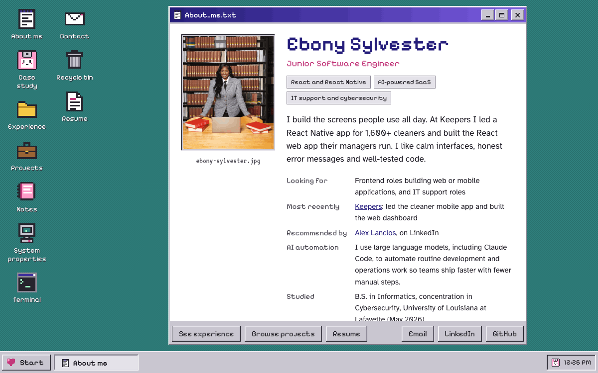

# EbonyOS

My portfolio, built as a retro 90s desktop: draggable windows, a Start menu, a working terminal and
Flop, a pink floppy-disk helper. I built it to learn Angular coming from React.



Built with Angular 22: signals, `@for` / `@if` control flow, native `animate.enter` / `animate.leave`
animations and standalone components. No UI library; the pixel icons are hand-drawn as strings in
`src/app/os/pixel-icon.ts`.

## Run it

```bash
npm install
npm start               # http://localhost:4300 (plain recruiter view at /resume)
npm test -- --watch=false
npm run build           # production build in dist/ebony-portfolio/browser
npm run resume:pdf      # reprint public/Ebony_Sylvester_Resume.pdf from /resume (needs npm start running)
npm run demo            # re-record docs/demo.gif (needs npm start running)
```

## Where things live

| Path | What |
|---|---|
| `src/app/data/resume.ts` | All the words: profile, roles, projects, skills |
| `src/app/os/` | The desktop: window manager, windows, taskbar, Start menu, boot screen, Flop |
| `src/app/apps/` | What opens in each window: About, Experience, Projects, System, Terminal, Contact, Recycle bin |
| `src/app/data/resume-doc.ts` + `src/app/resume-view/` | The one-page resume at /resume (must print to one page; check with `npm run resume:pdf`) |
| `public/` | Photo, resume PDF, link-preview image, project screenshots |

Try the terminal: `help`, `whoami`, `projects`, `open contact`, `hire`.

Link previews (LinkedIn, Slack) use the Open Graph tags in `src/index.html`; they point at
`https://ebony-sylvester.netlify.app`, so update them if the site address changes.

## After deploying

- **Contact form:** messages go through Netlify Forms. In the Netlify dashboard, turn on form
  detection and add an email notification for the "contact" form so messages reach your inbox.
- **Visitor stats:** sign up free at goatcounter.com, then set `GOATCOUNTER_CODE` in
  `src/app/os/analytics.ts`. It counts visits and which windows people open, with no cookies.
